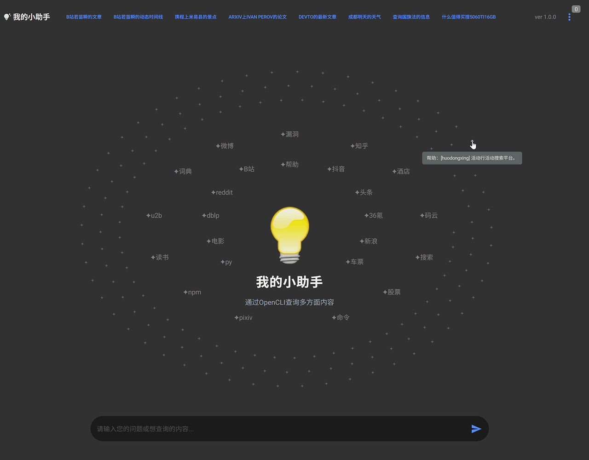
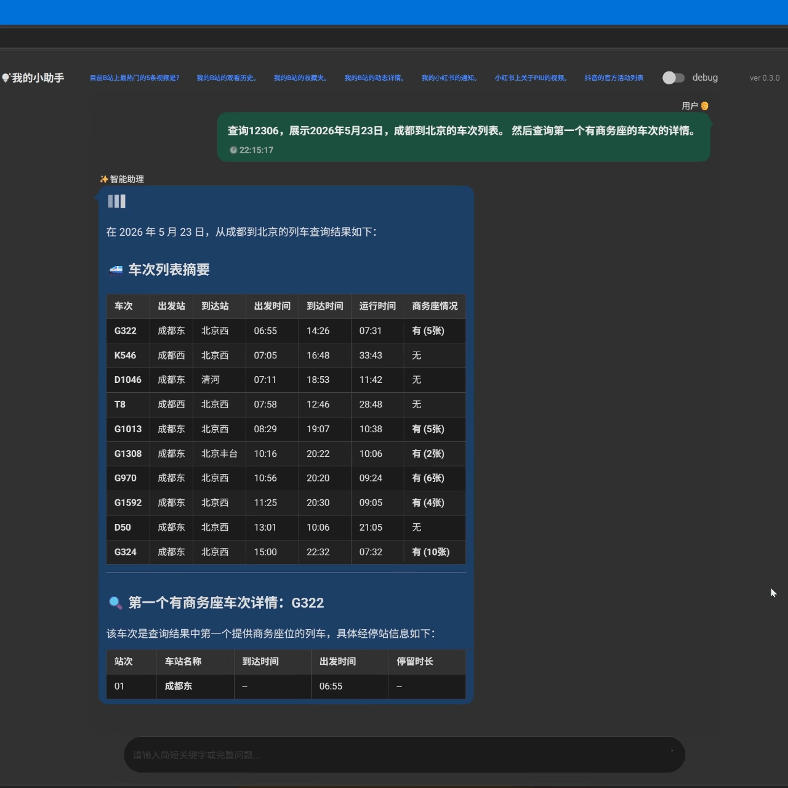
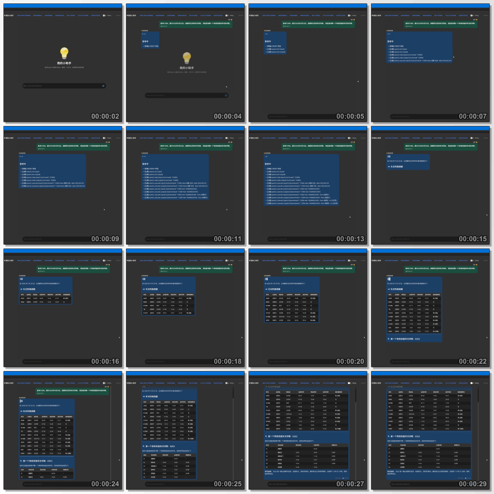

<div align="center">
  
  <h1>OpenCliWeb · My Little Assistant</h1>
  <p><strong>Query any website with one natural-language question — an OpenCLI-powered personal assistant</strong></p>
  <p>
    <a href="README.md">简体中文</a> ·
    <a href="README_en.md"><strong>English</strong></a>
  </p>
  <p>
    <a href="https://img.shields.io/github/license/ShionWakanae/OpenCliWeb" target="_blank"></a>
    <a href="https://img.shields.io/github/stars/ShionWakanae/OpenCliWeb?style=social" target="_blank"></a>
    
    
    
    
    
  </p>
</div>

---

> Query websites through natural language, built on top of [OpenCLI](https://github.com/jackwener/opencli).
> Because it runs against **your own logged-in browser session**, it behaves more like a personal assistant than a public crawler.

## Table of Contents

- [What Is This](#what-is-this)
- [Key Features](#key-features)
- [How It Differs from Using OpenCLI Directly](#how-it-differs-from-using-opencli-directly)
- [Screenshots](#screenshots)
- [Requirements](#requirements)
- [Quick Start](#quick-start)
- [Usage](#usage)
- [How It Works](#how-it-works)
- [Configuration](#configuration)
- [Supported Sites](#supported-sites)
- [Project Structure](#project-structure)
- [Troubleshooting](#troubleshooting)
- [Video Demo](#video-demo)
- [Credits](#credits)
- [License](#license)
- [Contributing](#contributing)

## What Is This

OpenCliWeb is a web project that turns [OpenCLI](https://github.com/jackwener/opencli) into a conversational assistant.

OpenCLI itself ships a set of *site adapters* that expose websites such as Bilibili, Zhihu, 12306, arXiv and Ctrip as command-line interfaces. You just state what you want in plain language; this project lets an LLM work out which commands to call, in what order, and how to turn the results into a readable answer.

Two entry points, pick either:

- **CLI** — a single `python src/open_cli.py "your question"`, good for scripting and quick lookups.
- **WebUI** — a NiceGUI chat interface that shows the reasoning and tool-call trace, good for everyday use.

The WebUI interface is inherited from the author's other project, [Llamarkdown](https://github.com/ShionWakanae/Llamarkdown).

## Key Features

1. **The LLM plans the call sequence** — you never have to memorise each site's command syntax; the model looks up the help first, then executes.
2. **The execution trace is fully visible** — every `site_help` / `cmd_exec` call and its return value is expanded in the WebUI's "Execution process" panel.
3. **Zero learning curve** — you only ask a question; the agent handles the rest.
4. **Proactive site hints** — the home page shows every available site in a spiral of stars with its purpose; click one to fill the question box.
5. **Cached site descriptions** — on startup, a one-line purpose description is generated for each site and stored on disk, which measurably improves the model's site-selection accuracy.
6. **Automatic result slimming** — item trimming, noisy-field removal and per-site special cases keep token usage down.
7. **Online or local LLMs** — any OpenAI-compatible endpoint works, including llama.cpp and Ollama.
8. **Guardrails included** — duplicate-command blocking, tool-loop limits and timeouts prevent the model from spinning and burning tokens.

## How It Differs from Using OpenCLI Directly

**Versus typing OpenCLI commands yourself:**

1. The LLM decides which commands to call and in what order.
2. The WebUI shows the full trace of multiple chained commands.
3. You only need to state the question or the goal.
4. All operable sites and usage examples are surfaced proactively.
5. The site list and descriptions are cached, which improves query success rates.

**Versus driving OpenCLI from an agent via skills:**

1. The flow and data structures are simplified — it focuses on one target type: the *site*.
2. An online LLM can save you a lot of tokens.
3. A local LLM is easier to keep "on task" and to complete the job reliably.
4. Roughly the difference between a bicycle and a car: easier downhill, cheaper uphill.

## Screenshots

| Home screen (spiral site browser) | Chat and tool calls |
| --- | --- |
|  |  |



## Requirements

| Dependency | Requirement | Notes |
| --- | --- | --- |
| Node.js | ≥ 21.0.0 (or Bun ≥ 1.0) | Required by OpenCLI; the project only verifies that the `node` command is available |
| Python | 3.10 (the version the author has verified) | 3.11 and above are untested |
| Chrome / Chromium | A recent version | Must be logged into the target sites, with the OpenCLI Browser Bridge extension installed |
| OpenCLI | Latest | `npm install -g @jackwener/opencli` |
| LLM API | Any OpenAI-compatible endpoint | Hosted (OpenAI, etc.) or local (llama.cpp, Ollama, etc.) |

> See the official docs for the complete OpenCLI installation guide: [Installation](https://opencli.info/docs/guide/installation.html) ([中文](https://opencli.info/docs/zh/guide/installation.html)).

## Quick Start

### 1. Install OpenCLI

```powershell
npm install -g @jackwener/opencli
```

Then install the browser extension — pick either way:

- **Chrome Web Store** (recommended): [install the OpenCLI extension](https://chromewebstore.google.com/detail/opencli/ildkmabpimmkaediidaifkhjpohdnifk).
- **Manual install**: download `opencli-extension-v{version}.zip` from the [GitHub Releases](https://github.com/jackwener/opencli/releases), unzip it, open `chrome://extensions`, enable Developer mode, and choose "Load unpacked". See the [Browser Bridge guide](https://opencli.info/docs/guide/browser-bridge.html).

Check the installation with the command below — all three items should report OK:

```powershell
opencli doctor
```

The project also runs `opencli doctor` once at startup. If it detects a browser profile that is not connected, it will try `opencli profile use <profile>` and retry.

### 2. Clone the repository and install dependencies

```powershell
git clone https://github.com/ShionWakanae/OpenCliWeb.git
cd OpenCliWeb
python -m venv venv
.\venv\scripts\activate
pip install -r requirements.txt
```

### 3. Configure environment variables

```powershell
copy .env_sample .env      # Windows
```

```bash
cp .env_sample .env        # macOS / Linux
```

Edit `.env` and fill in at least `STORAGE_SECRET`, `LLM_API_BASE`, `LLM_API_KEY` and `LLM_MODEL` — startup fails immediately if any of them is missing. Also set `WEBUI_USERNAME` / `WEBUI_PASSWORD`, otherwise you cannot log in to the WebUI. See [Configuration](#configuration) for details.

### 4. Run it

> ⚠️ Always run from the **project root**. The code uses relative paths to read `data/` and `src/ui/`, so running from a subdirectory breaks the site cache and static assets.

CLI mode:

```powershell
python .\src\open_cli.py "the 5 hottest videos on Bilibili"
```

WebUI mode:

```powershell
python .\src\open_web.py
```

Then open <http://127.0.0.1:7860/> in your browser and sign in with the username and password from `.env`.

The repository also ships convenience scripts that activate the virtual environment for you:

```powershell
.\run_cli.ps1        # CLI
.\run_webui.ps1      # WebUI
```

## Usage

### CLI mode

```powershell
python .\src\open_cli.py "your question" [--Think] [--Verbose]
```

| Flag | Purpose |
| --- | --- |
| `--Think` | Enable reasoning mode — the model's thinking is streamed separately; when off, the model is asked to disable thinking |
| `--Verbose` | Verbose logs: model name, tool calls, timings, token statistics |

The terminal prints, in order: your question → the tool-call trace → the final answer → timing breakdown (Retrieval / Answers / Total) → token counts and generation speed.

### WebUI mode

| Feature | Notes |
| --- | --- |
| Login page | Uses `WEBUI_USERNAME` / `WEBUI_PASSWORD` from `.env` |
| Spiral home screen | Every star is an available site; hover for its purpose, click to fill the question box |
| Quick questions | A row of example questions across the top, one click to send |
| Reasoning toggle | The "推理" switch in the top-right, equivalent to `--Think` on the CLI |
| Execution trace panel | The "执行过程" expander next to each answer shows live model stages, tool calls and their outputs |
| Answer rendering | Markdown with MathJax formula support |
| Session management | The menu can clear the conversation or log out; chat history is stored per user in NiceGUI storage and survives a refresh |
| Status readout | Each answer footer shows the model name, elapsed time, a speed indicator and a timestamp |

## How It Works

```
User question
   │
   ▼
┌───────────────┐   System prompt carries the site list + tool schemas
│ ① LLM plans  │   site_help / cmd_exec
└───────┬───────┘
        │  Match the intent to the closest site
        ▼
┌───────────────┐   opencli <site> --help
│ site_help(site)│  → every command and parameter of that site
└───────┬───────┘
        │  ② Assemble the full command string
        │     (no opencli / cmd / -f prefix)
        ▼
┌───────────────┐   opencli <site> <cmd> ... -f yaml
│ cmd_exec(cmd)  │  → real data (parsed as JSON / YAML)
└───────┬───────┘
        │  ③ Clean the result: trim items, drop noisy
        │     fields, apply per-site special cases
        ▼
┌───────────────┐   Render a Markdown answer in LANGUAGE
│  Compose answer│
└───────────────┘
```

**The two tools**

- `site_help(site)` — lists every available command and parameter of a single site.
- `cmd_exec(full_cmd, result_trim?)` — executes one complete site command.

**Key design points**

- **Duplicate-command blocking** — re-running an identical command is rejected with a hint, so the model cannot spin on the same call.
- **Loop protection** — more than 5 calls with the same tool and arguments, or more than 99 rounds in total, aborts the run and tells the user.
- **Result trimming** — the command's own `--limit` is preferred; when the command does not support it, `result_trim` truncates the returned items.
- **Field slimming** — fields such as `image_url`, `browser`, `domain` and `access` are stripped automatically to save tokens.
- **Per-site special cases** — toutiao URLs are cleaned of query parameters; the 12306 "seat still available" field is removed so the model cannot misread it.
- **Two tool-call formats** — standard function calling is supported, and so is the XML-style tool call that some models emit directly.
- **Site list cache** — the site list comes from `opencli --help`; at startup a one-line purpose description is generated for each site and cached in `data/sites_metadata.json`, and only changed entries are refreshed afterwards.

## Configuration

Configure everything in `.env`; see [`.env_sample`](.env_sample) for a complete template.

| Variable | Required | Default | Description |
| --- | --- | --- | --- |
| `STORAGE_SECRET` | ✅ | — | NiceGUI session storage secret — any fixed string |
| `LLM_API_BASE` | ✅ | — | OpenAI-compatible API base URL, e.g. `https://api.openai.com/v1` or a local `http://127.0.0.1:8080/v1` |
| `LLM_API_KEY` | ✅ | — | API key |
| `LLM_MODEL` | ✅ | — | Model name, e.g. `gpt-4.1-mini`; must support function calling |
| `WEBUI_USERNAME` | recommended | — | WebUI login username; the UI is unreachable without it |
| `WEBUI_PASSWORD` | recommended | — | WebUI login password |
| `HOST` | | `0.0.0.0` | WebUI bind address; `.env_sample` ships `127.0.0.1` (localhost only) |
| `PORT` | | `7860` | WebUI port |
| `LANGUAGE` | | `简体中文` | Language used for answers — set `English` for English output |

## Supported Sites

The site list is defined by OpenCLI and changes with upstream releases; it currently holds around 160 sites. Here are common examples grouped by purpose:

| Category | Examples |
| --- | --- |
| Social / Communities | bilibili, weibo, zhihu, xiaohongshu, reddit, v2ex, tieba, hupu, jike, linux-do |
| Video / Audio | youtube, douyin, tiktok, spotify, suno, apple-podcasts, wechat-channels |
| News / Finance | toutiao, 36kr, sinafinance, eastmoney, reuters, bbc, bloomberg, xueqiu |
| Academic / Papers | arxiv, dblp, pubmed, openalex, semanticscholar, cnki, wanfang, paperreview |
| Tech / Development | github, gitee, stackoverflow, npm, pypi, dockerhub, maven, mdn, nvd, endoflife |
| Life / Services | ctrip, 12306, dianping, taobao, jd, 1688, guazi, douban, imdb, dictionary |
| Jobs / Careers | 51job, boss, linkedin, linkedin-learning, upwork |
| Tools / Misc | wikipedia, wikidata, google, duckduckgo, yahoo, producthunt, steam, chess |

To see the full list:

```powershell
opencli list          # every site and command
opencli list -f yaml  # YAML output
```

The cached sites and their descriptions live in `data/sites_metadata.json`.

## Project Structure

```
OpenCliWeb/
├── README.md                 # Chinese documentation
├── README_en.md              # English documentation
├── LICENSE                   # MIT license
├── requirements.txt          # Python dependencies
├── pyproject.toml            # ruff configuration
├── .env_sample               # Environment variable template
├── run_cli.ps1               # Activates the venv (CLI entry point)
├── run_webui.ps1             # Activates the venv and starts the WebUI
├── data/                     # Generated at runtime: site description cache (not tracked)
│   └── sites_metadata.json
├── res/                      # Image assets
│   ├── logo.png
│   ├── webui_0.png / webui.png / webui_1.png
│   └── cat_typing.gif
└── src/
    ├── open_cli.py           # CLI entry point
    ├── open_web.py           # WebUI entry point (NiceGUI)
    ├── services/
    │   └── opencli_service.py # Service bootstrap, self-checks, event stream
    ├── opencli/
    │   ├── IntelligentAgent.py # LLM agent: tool loop, reasoning toggle
    │   ├── OpenCLITool.py      # Tool implementations: site_help / cmd_exec
    │   └── SiteAgent.py        # Automatic site description generation
    ├── ui/
    │   ├── css/app.css
    │   └── js/chat_scroll.js
    └── utils/
        ├── settings.py       # Configuration loading and validation
        ├── logger.py         # Logging
        ├── json_extractor.py # Safe JSON field extraction
        └── charstrings.py    # Terminal width handling
```

## Troubleshooting

**`node.js check failed` at startup**
Node.js is missing or not on `PATH`. Install Node.js ≥ 21.0.0 and open a new terminal.

**`opencli check failed` at startup**
OpenCLI is not installed. Run `npm install -g @jackwener/opencli` and confirm with `opencli --version`.

**`opencli doctor validation failed` at startup**
Not all three `opencli doctor` checks passed. Work through them one by one:

- `Daemon: running` — the local daemon is down. Any opencli browser command starts it automatically; `opencli daemon status` shows its state.
- `Extension: connected` — the browser extension is not connected. Confirm Chrome is running with the Browser Bridge extension enabled.
- `Connectivity: connected` — the target site is unreachable. Confirm you are logged into that site in Chrome.
- `Browser profile "xxx" is not connected` — the project automatically tries `opencli profile use xxx` and retries; you can also run it manually.

See the [OpenCLI troubleshooting guide](https://opencli.info/docs/guide/troubleshooting.html).

**The first query is very slow**
On the first run, a one-line purpose description is generated for every site (the LLM reverse-engineers it from the site's help output) and written to `data/sites_metadata.json`. After that only changed entries are refreshed, so subsequent runs are fast.

**A site description is wrong / I want to rebuild the cache**
Delete `data/sites_metadata.json` and restart — it is rebuilt automatically. You can also edit the `desc` field by hand.

**The WebUI says "wrong username or password"**
Make sure `WEBUI_USERNAME` and `WEBUI_PASSWORD` are set in `.env` (the code has no defaults for them, so they default to `None`).

**The port is already in use**
Change `PORT` in `.env`.

**A local model returns a 400 / parameter error**
The project adds llama.cpp-style extension fields (`enable_thinking`, `reasoning_strength`) to the request body. Some OpenAI-compatible endpoints reject them — try removing them from `extra_body` in `src/opencli/IntelligentAgent.py`.

**PowerShell: "cannot load Activate.ps1"**
This is an execution-policy restriction. Run `Set-ExecutionPolicy -Scope CurrentUser RemoteSigned` and try again.

**Must I run from the project root?**
Yes. The code reads `data/` and `src/ui/` through relative paths, so running from a subdirectory breaks the site cache and static assets.

**How do I get English answers?**
Set `LANGUAGE=English` in `.env`.

## Video Demo

Click to open the video on Bilibili:

[](https://www.bilibili.com/video/BV1DNG86eEr3)

## Credits

- [OpenCLI](https://github.com/jackwener/opencli) — provides the underlying site adapters and the browser bridge (Apache-2.0 licensed).
- [Llamarkdown](https://github.com/ShionWakanae/Llamarkdown) — source of the WebUI interface.
- [NiceGUI](https://github.com/zauberzeug/nicegui) — the web framework.

Author:

[](https://blog.csdn.net/ddrfan?type=blog)
[](https://space.bilibili.com/688222797)

## License

[](LICENSE)

This project is open-sourced under the MIT license. You are free to use, modify and distribute the code as long as you comply with the license terms.

## Contributing

Issues and pull requests are welcome.

- Please read the [How It Works](#how-it-works) section first so you know how the current implementation works.
- After your change, make sure both the CLI and the WebUI still run.
- Documentation changes should update `README.md` and `README_en.md` together so both versions stay in sync.
